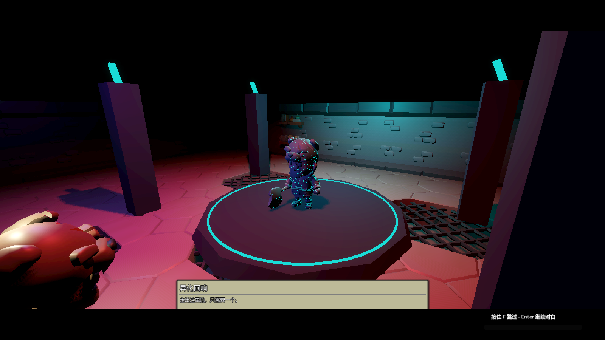
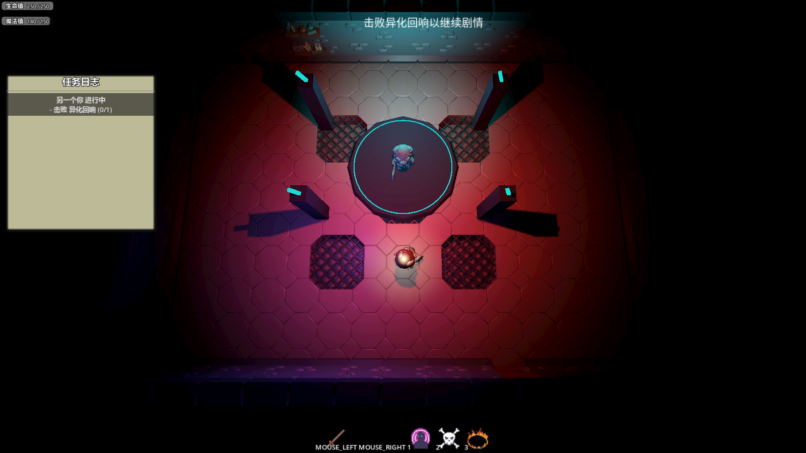
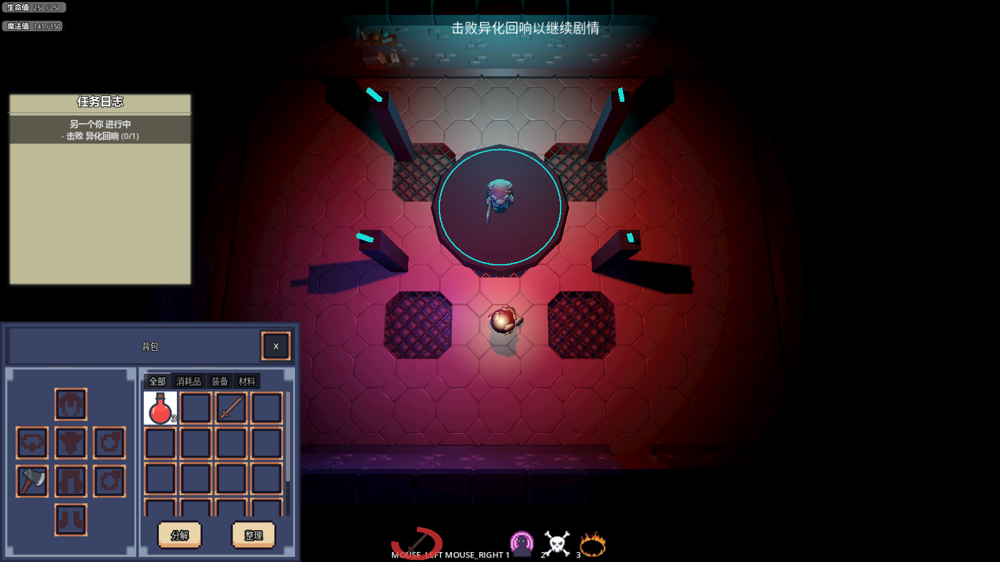

# Godot Simple ARPG Demo

[](https://github.com/LiGameAcademy/godot_simple_arpg_demo/actions/workflows/validate.yml)
[](https://github.com/LiGameAcademy/godot_simple_arpg_demo/stargazers)

[简体中文](README_zh-CN.md) · [Narrative plugin](https://github.com/LiGameAcademy/laoli_dialogue_system) · [Gameplay abilities plugin](https://github.com/LiGameAcademy/godot_gameplay_abilities) · [Inventory plugin](https://github.com/LiGameAcademy/laoli_simple_inventory)

A low-poly Godot prototype combining room exploration, NPC dialogue and quests, resource-driven cutscenes, a gameplay ability system, attributes/vitals, talents, equipment, and instance-based inventory.

> For more Godot learning resources and to support future development, visit [LiGameAcademy on Patreon](https://www.patreon.com/cw/LiGameAcademy).

[itch.io](https://godot-li.itch.io/)

The recorded-course narrative contracts remain covered by regression checks. The pre-integration narrative build is preserved at `archive/2026-11-02/before-feature-integration`; recorded-course tags remain unchanged.

## Screenshots



| Boss encounter and quest progress | Inventory and equipment in the game |
| --- | --- |
|  |  |

Actual Godot 4.7.2 runtime captures, Chinese UI shown. Developer overlays were hidden for capture. [Versions and scenes](docs/screenshots/README.md).

## Requirements and setup

Use **Godot 4.7.2**. Godot 4.5 compatibility is not claimed.

```sh
git clone --recurse-submodules https://github.com/LiGameAcademy/godot_simple_arpg_demo.git
cd godot_simple_arpg_demo
git submodule update --init --recursive
```

Open `project.godot`, wait for resource import, and run the main scene. Narrative, gameplay abilities and inventory are pinned Git submodules. Inventory uses the plugin-only `laoli_simple_inventory` repository at `addons/simple_inventory`; its complete source/teaching project is maintained separately. Upgrades must update and validate the dependency pointers explicitly.

## Integrated systems

- NPC choices, action/condition registration, quest acceptance, collect/kill objectives and rewards.
- Boss introduction and resolution sequences with matching dialogue sessions, skip/cancel/failure cleanup and input locks.
- Character health/mana and attributes, combo attack, dash, fireball, arcane missiles and sacrifice skills.
- Independent item instances, potion use, axe/staff equipment, attribute/skill/model changes and inventory snapshots.
- Talent UI, ability and vital HUDs, camera shake, and optional debugging tools.
- Real boss health and combat feed the narrative defeat/result flow. Debug defeat remains available separately.

The host owns world rules, actors, camera presentation, rewards and save policy. Shared dialogue/quest/cutscene code lives in the narrative plugin.

The inventory dependency includes the successful-receipt event used by collection objectives; it does not count snapshot restore as acquisition. Its default UI now uses verified Cryo textures; item icons and the font have separate [asset notices](addons/simple_inventory/THIRD_PARTY_NOTICES.md). Inventory snapshot version and host gameplay bindings are unchanged by this dependency migration.

## Controls

| Input | Action |
| --- | --- |
| WASD | Move |
| E | Interact with a focused object |
| Left mouse | Combo attack |
| Right mouse | Dash |
| 1 / 2 / 3 | Fireball / arcane missiles / sacrifice |
| B | Inventory and equipment |
| T / P | Talent tree / debug grant one talent point |
| F | Skip current cutscene |
| K | Debug boss defeat after introduction |
| F5 / L | Save / restore a narrative checkpoint |
| F6 / F8 | Save / restore inventory and equipment |
| Ctrl+Shift+C | Behavior tree debug panel |
| F7 | Toggle the attribute panel |
| Ctrl+T | Toggle the tag debug panel |

Narrative checkpoints store story flags, quest progress and minimal dialogue history; they restore stable narrative phases and revive the player. Inventory/equipment persistence is separate. Neither format is a complete world/character save, and ordinary enemy state is not rewound by narrative restore.

## Versions and branches

`master` is the protected stable branch. Temporary integration branches are merged through PRs, validated, and then removed. Historical course tags and archive tags preserve earlier implementations. A branch is removed only after its tip is reachable from the integrated mainline or explicitly archived.

The archived inventory trial referenced an unavailable ability-system commit. The integrated dependency must point to a published, tested commit; a missing trial gitlink is not a supported installation.

## Validation

The integration checks cover narrative outcomes/checkpoints, real combat, skill locking, consumables, equipment and inventory persistence. See the repository tests and the linked dependency documentation. Gameplay tuning and final presentation remain prototype work.

Godot 4.7.2 validation covers import, the recorded narrative flow, inventory, real combat, talents and spells. The debug window starts hidden in its scene so editor previews do not open it before runtime initialization. See [integration notes](docs/integration_status.md) for dependency versions and the precisely documented pre-existing GAS script-retention diagnostic.
