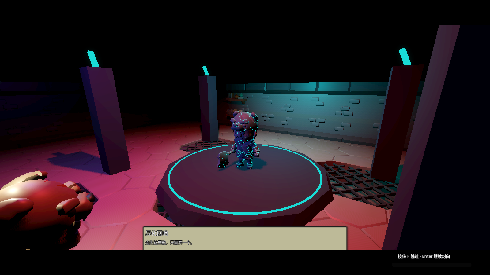
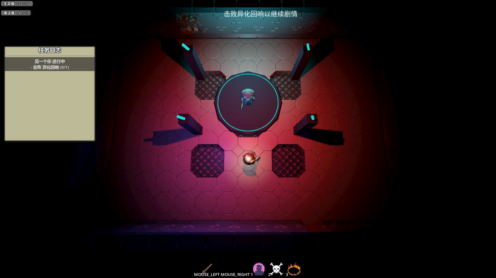
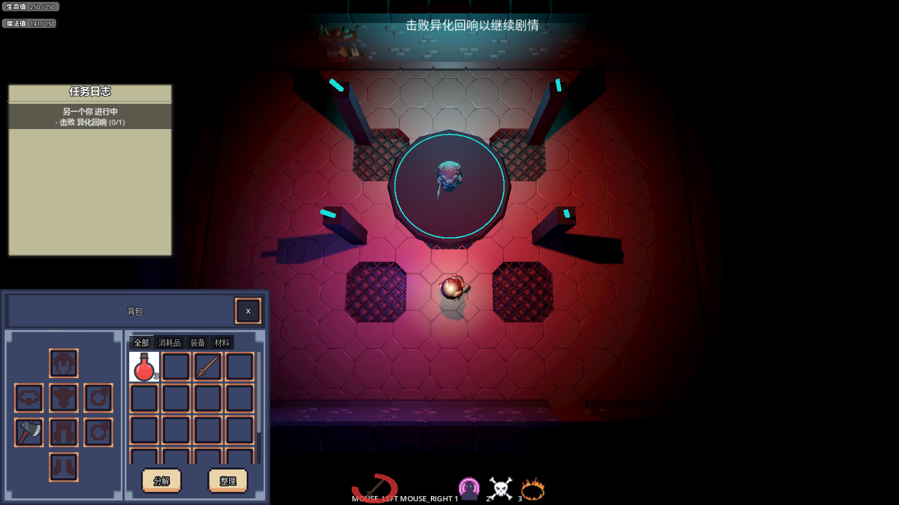

# Godot 简易 ARPG 演示工程

[English](README.md) · [叙事插件](https://github.com/LiGameAcademy/laoli_dialogue_system) · [背包插件](https://github.com/LiGameAcademy/laoli_simple_inventory)

Low-Poly 原型：房间探索、NPC 对话与任务、剧情演出、技能、属性与生命/法力、天赋、装备和实例化背包。录制课程的剧情契约继续由回归检查覆盖；整合前版本保留在 `archive/2026-11-02/before-feature-integration`。

> 想继续学习 Godot、获取更多项目学习资源并参与交流，欢迎加入[老李游戏学院知识星球](https://wx.zsxq.com/group/28885154818841)。

## 实机截图

| Boss遭遇与任务进度 | 游戏中的背包与装备 |
| --- | --- |
|  |  |

Godot4.7.2实际运行截图；取景时隐藏开发调试覆盖层。[截图版本与场景](docs/screenshots/README.md)。

## 运行

使用 Godot 4.7.2。递归克隆仓库，或检出后执行 `git submodule update --init --recursive`，等待资源导入后运行主场景。叙事、技能与背包插件均固定为子模块提交；背包使用插件根目录发行库 `laoli_simple_inventory`，路径仍为 `addons/simple_inventory`，完整教学源工程独立维护。不宣称已验证 Godot 4.5。

## 功能与职责

对话、任务、历史与演出执行核心由叙事插件提供；ARPG 自己维护演员、镜头、具体剧情、任务提交与奖励。战斗提供连击、冲刺、火球、奥术飞弹、献祭、属性与生命/法力。背包提供药水、斧子和法杖装备、属性/技能/模型联动及独立快照。Boss 的真实生命值与击败结果衔接剧情收尾；调试击败入口单独保留。

背包发行版已包含收集任务使用的成功入包事件，完整堆叠会通知，读档不计入。默认界面改用已核对来源的Cryo素材，图标和字体许可见[素材署名](addons/simple_inventory/THIRD_PARTY_NOTICES.md)。本次依赖迁移不改变背包快照版本与宿主玩法接口。

## 操作

- WASD 移动，E 交互，鼠标左键连击、右键冲刺。
- 1 / 2 / 3：火球 / 奥术飞弹 / 献祭；B 背包，T 天赋树，P 调试增加天赋点。
- F 跳过演出，K 调试击败已入场的 Boss。
- F5 保存叙事检查点，L 恢复；F6 保存背包和装备，F8 读取。
- Ctrl+Shift+C 打开行为树调试面板。

叙事检查点保存剧情标记、任务与最小对白历史，恢复稳定阶段并复活玩家；背包和装备独立保存。它们不是完整世界或角色存档，叙事恢复不会重置普通敌人的状态。

## 版本与分支

master 是受保护稳定分支；临时整合分支通过 PR 和验证后清理。课程录制标签与归档标签保留，不随新功能移动。只有已被主线包含或明确归档的分支才清理。

原背包试验引用了远端不可取得的技能系统提交，正式整合必须固定到已发布且验证过的依赖。功能验收覆盖演出、检查点、真实战斗、输入锁、消耗品、装备和存读档；数值与最终表现仍是原型阶段。

Godot 4.7.2 验证覆盖导入、课程剧情、背包、真实战斗、天赋和法术。调试窗口在场景中默认隐藏，避免编辑器预览在运行初始化前打开窗口；依赖版本和精确记录的技能插件既有脚本资源保留诊断见[整合说明](docs/integration_status.md)。
