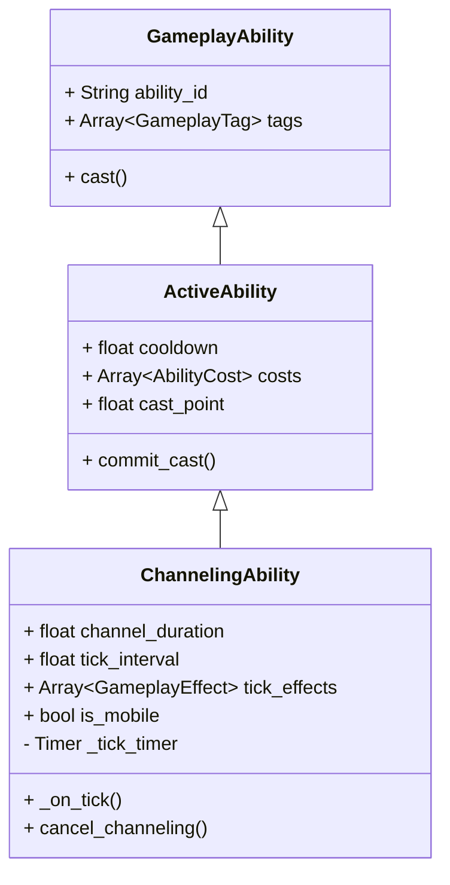

这是一份关于 **引导类技能 (Channeling Ability)** 的详细设计文档。这份文档基于通用的 Gameplay Ability System (GAS) 架构思想，并结合了我们之前讨论的 Godot 实现方式。

-----

# 引导类技能 (Channeling Ability) 设计文档

| 文档信息 | 内容 |
| :--- | :--- |
| **类型** | 核心机制设计 |
| **涉及系统** | GAS (Ability, Effect, Tags), 动画系统, 输入系统 |
| **版本** | v1.0 |
| **状态** | 草稿 / 待评审 |

-----

## 1\. 概述 (Overview)

### 1.1 定义

**引导类技能**是指需要角色在一段时间内持续保持某种状态（通常是施法动作）才能完整释放效果的技能。

与瞬发技能（Instant）或单纯有前摇的技能（Cast Point）不同，引导技能的核心特征在于\*\*“持续性”**和**“可中断性”\*\*。

### 1.2 典型特征

1.  **持续时间 (Duration)：** 技能有一个最大持续时间。
2.  **周期性效果 (Tick)：** 在引导过程中，通常会每隔固定时间间隔触发一次效果（如每 0.5 秒造成一次伤害）。
3.  **持续消耗 (Continuous Cost)：** 引导期间通常会持续消耗资源（如每秒扣除魔法值）。
4.  **状态锁定 (State Lock)：** 引导期间角色通常处于特定的动画状态，可能会被限制移动或执行其他动作。
5.  **可中断 (Interruptible)：** 引导过程非常脆弱，容易被外部因素（如眩晕、沉默）或内部因素（如玩家主动移动、资源不足）打断。

### 1.3 示例

  * **暴风雪 (Blizzard)：** 在指定区域持续落下冰锥，对区域内敌人造成周期性伤害并减速。施法者不能移动。
  * **生命吸取 (Drain Life)：** 持续连接一个目标，每秒吸取其生命值给自己回血。需要持续瞄准目标。
  * **旋风斩 (Whirlwind)（引导版）：** 按住按键持续旋转攻击周围敌人，可以缓慢移动，持续消耗体力。

-----

## 2\. 核心机制设计 (Core Mechanics)

### 2.1 激活方式

引导技能通常有两种激活模式：

  * **按住维持 (Hold to Channel)：** 玩家必须按住技能键不放。松开按键则引导结束（这是最常见的模式）。
  * **切换式 (Toggle)：** 按一下开始引导，再按一下手动停止，或者直到时间结束/被打断。

*设计决策：优先支持“按住维持”模式，因为交互反馈最直接。*

### 2.2 时间轴结构

引导技能的时间轴比普通技能复杂，它包含三个主要阶段：

1.  **引导开始 (Start / OnActivate)：**

      * 扣除初始消耗（如果有）。
      * 进入引导动画状态。
      * 给自己打上 `State.Casting.Channeling` 标签。
      * 触发“开始时效果”（可选，如一道强光）。

2.  **引导循环 (Loop / Ticking)：**

      * 这是核心阶段。启动一个计时器。
      * **每隔 `tick_interval` (周期时间)：**
          * 检查是否满足继续引导的条件（资源是否足够？是否被控制？）。
          * 如果满足，扣除周期性消耗。
          * 触发“周期性效果 (Tick Effect)”。
      * 持续监测打断条件（如玩家松手、收到眩晕Tag）。

3.  **引导结束 (End)：**

      * **正常完成 (Completed)：** 达到最大持续时间。触发“完成时效果”（可选，如最后一次大爆炸）。
      * **被打断 (Interrupted/Cancelled)：** 中途停止。通常不触发完成效果。
      * **清理工作：** 移除 `State.Casting.Channeling` 标签，停止动画，停止音效与特效。

### 2.3 移动性 (Mobility)

引导期间是否允许移动是一个关键的设计参数。

  * **静止引导 (Stationary)：** 引导期间移动会立即打断技能。（如：读条炎爆术）
  * **移动引导 (Mobile)：** 引导期间可以移动，但通常会有速度惩罚，或者限制转向。（如：旋风斩、移动射击）

-----

## 3\. 技术架构 (Technical Architecture - GAS)

我们将创建一个新的基类 `ChannelingAbility`，继承自现有的 `ActiveAbility`。

### 3.1 类结构



### 3.2 关键数据字段 (Data Fields)

在 `ChannelingAbility` 中新增以下导出的配置变量：

| 字段名 | 类型 | 默认值 | 说明 |
| :--- | :--- | :--- | :--- |
| `channel_duration` | float | 3.0 | 最大引导持续时间（秒）。 |
| `tick_interval` | float | 0.5 | 触发周期性效果的时间间隔（秒）。如果\<=0则不触发周期效果。 |
| `cost_per_tick` | Array[Cost] | [] | 每个周期扣除的资源消耗。 |
| `tick_effects` | Array[GE] | [] | 每个周期对目标应用的效果列表（如周期伤害）。 |
| `completion_effects` | Array[GE] | [] | **仅在**完整引导结束时触发的效果。 |
| `channeling_self_buffs` | Array[GE] | [] | 引导期间施加给自己的 Buff（如增加防御，引导结束时移除）。 |
| `is_mobile` | bool | false | 是否允许移动引导。如果为 false，移动输入将打断引导。 |
| `stop_on_input_release`| bool | true | 是否在松开按键时停止引导（True=按住维持，False=切换式）。 |

### 3.3 核心逻辑伪代码

`ChannelingAbility` 需要重写基类的核心流程。

```gdscript
# ChannelingAbility.gd (伪代码)
extends ActiveAbility
class_name ChannelingAbility

var _current_channel_time: float = 0.0
var _tick_accumulator: float = 0.0
var _is_channeling: bool = false

# 重写：主要的施法逻辑
func _on_cast(ability_comp, target, context) -> void:
    # 1. 初始检查与扣费（沿用基类逻辑）
    if not super._can_cast(...): return
    super._commit_cast(...) # 扣除初始费用，开始冷却

    # 2. 开始引导状态
    _start_channeling(ability_comp, target, context)

func _start_channeling(ability_comp, target, context):
    _is_channeling = true
    _current_channel_time = 0.0
    _tick_accumulator = 0.0
    
    # 核心：给自己打上正在引导的标签
    # 这对于防止重复施法、通知动画系统非常重要
    status_comp.add_tag("state.casting.channeling")
    
    # 播放引导动画（循环动作）
    visual_adapter.play_loop_animation(animation_name)
    
    # 应用自身 Buff（如果有）
    _apply_self_buffs()

    # 开启处理循环 (Godot 中可以使用 _process 或者 Timer)
    set_process(true) 

# 每帧更新（用于处理计时和中断检查）
func _process(delta):
    if not _is_channeling: 
        set_process(false)
        return
        
    _current_channel_time += delta
    _tick_accumulator += delta
    
    # --- 中断检查 ---
    # 1. 检查是否被控制 (如眩晕/沉默)
    if status_comp.has_any_tag(["state.status.stunned", "state.status.silenced"]):
        cancel_channeling("interrupted")
        return

    # 2. 检查按键释放 (如果是按住维持模式)
    if stop_on_input_release and not Input.is_action_pressed(current_input_action):
        cancel_channeling("cancelled_by_player")
        return
        
    # 3. 检查移动 (如果是静止引导)
    if not is_mobile and instigator.is_moving():
        cancel_channeling("cancelled_by_movement")
        return

    # --- 周期性逻辑 (Tick) ---
    if tick_interval > 0 and _tick_accumulator >= tick_interval:
        _tick_accumulator -= tick_interval
        _perform_tick()
        
    # --- 完成检查 ---
    if _current_channel_time >= channel_duration:
        _complete_channeling()

# 执行一次 Tick
func _perform_tick():
    # 1. 检查并扣除周期性消耗
    if not _try_pay_tick_cost():
        cancel_channeling("out_of_resource")
        return
        
    # 2. 应用周期性效果 (给目标)
    # 注意：需要重新获取目标，因为目标可能移动了 (例如持续激光)
    var current_targets = _resolve_targets(...) 
    _apply_effects(current_targets, tick_effects)
    print("Channel tick triggered!")

# 成功完成引导
func _complete_channeling():
    print("Channel complete!")
    # 应用完成效果
    var targets = _resolve_targets(...)
    _apply_effects(targets, completion_effects)
    _stop_channeling(true)

# 主动/被动取消引导（对外接口）
func cancel_channeling(reason: String = ""):
    if not _is_channeling: return
    print("Channel cancelled. Reason: ", reason)
    _stop_channeling(false)

# 停止引导的通用清理逻辑
func _stop_channeling(was_completed: bool):
    _is_channeling = false
    set_process(false)
    
    # 清理标签
    status_comp.remove_tag("state.casting.channeling")
    
    # 停止动画/过渡到结束动画
    visual_adapter.stop_loop_animation()
    
    # 移除自身 Buff
    _remove_self_buffs()
    
    # 通知组件技能结束
    ability_comp.notify_ability_ended(ability_id)
```

-----

## 4\. 标签与状态交互 (GameplayTags Interaction)

引导技能高度依赖 GameplayTags 来管理状态和处理打断。

| 标签 (Tag) | 所有者 | 作用 |
| :--- | :--- | :--- |
| `State.Casting.Channeling` | 施法者 | **核心标签**。表示角色当前正在进行引导。用于动画状态机切换，以及阻止释放其他互斥技能。 |
| `Ability.Type.Channeling` | 技能资源 | 静态标签，标识该技能属于引导类。 |
| `State.Status.Stunned` | 施法者 | **打断标签**。如果施法者获得此标签（被晕），引导必须立即停止。 |
| `State.Status.Silenced` | 施法者 | **打断标签**。同上，被沉默也会打断引导。 |
| `State.Buff.Unstoppable` | 施法者 | **免疫标签**（可选）。如果施法者有此标签（如霸体），则眩晕等控制标签不会打断引导。 |

-----

## 5\. 表现层设计 (Visuals & Audio)

引导技能在表现层需要明确的“开始-循环-结束”三段式反馈。

1.  **动画 (Animation)：**

      * **Start Anim:** 引导开始时的前摇动作（如果有）。
      * **Loop Anim:** 引导持续期间的循环动作（核心）。
      * **End Anim (Success):** 成功释放后的收招动作。
      * **End Anim (Cancel):** 被打断时的急停/受击动作。

2.  **特效 (VFX)：**

      * **施法者特效:** 在施法者身上播放的持续特效（如魔法阵、能量汇聚）。需要随引导结束而消失。
      * **目标/轨道特效:** 连接施法者和目标的特效（如激光束、吸血链），或者在目标区域的持续特效（如暴风雪区域）。
      * **Tick 特效:** 每次 Tick 触发时的瞬间特效（如目标身上爆一下）。

3.  **音效 (SFX)：**

      * **Start Sound:** 开始引导的声音。
      * **Loop Sound:** 持续播放的循环音效（如能量嗡嗡声、风声）。**需要在引导结束时淡出停止。**
      * **Impact Sound:** 每次 Tick 命中目标的音效。

注意：特效音效可以采用cue系统实现。
-----

## 6\. 边缘情况与注意事项 (Edge Cases)

1.  **目标丢失：** 如果是针对特定目标的引导（如吸血），在引导过程中目标死亡或脱离范围怎么办？
      * *策略：* 通常应立即停止引导，或尝试寻找新目标（取决于具体设计）。
2.  **极短的 Tick 间隔：** 如果 `tick_interval` 设置得太小（如 0.01秒），会导致严重的性能问题和数字崩坏。
      * *策略：* 在编辑器脚本中限制最小值为 0.1秒或更长。
3.  **资源临界点：** 玩家蓝量刚好够初始消耗，但不够第一次 Tick 消耗。
      * *结果：* 技能会成功开始，播放开始动画，但在第一次 Tick 时立即因缺蓝而中断。这是符合预期的行为。